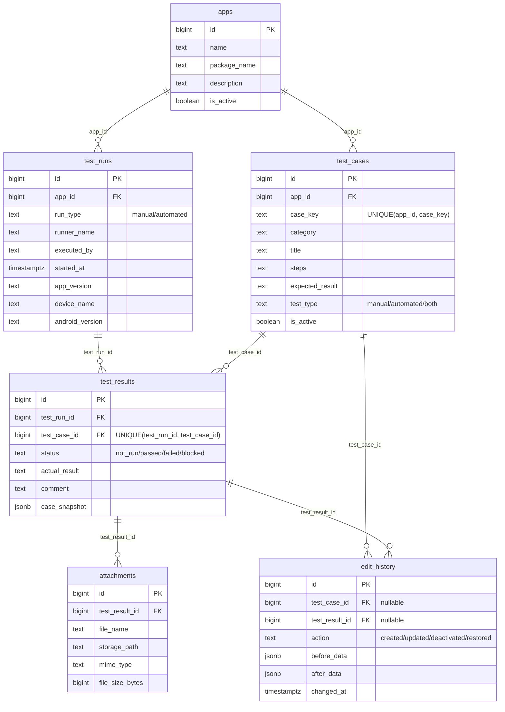

# Androidテスト結果台帳 ER図・DB設計

要件定義は [requirements.md](requirements.md) を参照。実際のスキーマは `backend/schema.sql`。

## ER図



主要でない列（作成・更新日時など）は図では省略している。全列は下記の論理設計を参照。

## 1. 論理設計

初版は以下の6テーブルを基本とする。列の型・制約・インデックスはExcel棚卸しとMaestro PoC後に物理設計で確定する。

### 1.1 `apps` — テスト対象アプリ

- `id` (PK)
- `name`
- `package_name`（任意）
- `description`（任意）
- `created_at`, `updated_at`
- `is_active`

### 1.2 `test_cases` — テスト項目

- `id` (PK)
- `app_id` (FK → `apps.id`)
- `case_key`（アプリ内で一意な識別子）
- `category`（カテゴリ名）
- `title`
- `precondition`（任意）
- `steps`（複数手順を含められる単一テキスト）
- `expected_result`
- `test_type`（manual / automated / both）
- `sort_order`
- `created_at`, `updated_at`
- `is_active`（削除ではなく無効化に使用）

テスト項目の増減は、このテーブルのレコード追加・編集・無効化で行う。項目ごとにDBスキーマを変える動的フィールド方式は初版では採用しない。

### 1.3 `test_runs` — テスト実行環境・実行回

- `id` (PK)
- `app_id` (FK → `apps.id`)
- `run_type`（manual / automated）
- `runner_name`（例: Maestro。任意）
- `executed_by`（認証を導入しない場合は自由記述またはNULL）
- `started_at`, `finished_at`
- `app_version`
- `device_name`, `android_version`（任意）
- `notes`（任意の補足情報。追加の実行環境項目はExcel棚卸し後に必要な列だけ追加する）
- `summary`, `created_at`

「誰が・いつ・どのアプリ版・どの端末／OSで実行したか」を記録する。

### 1.4 `test_results` — テスト結果履歴

- `id` (PK)
- `test_run_id` (FK → `test_runs.id`)
- `test_case_id` (FK → `test_cases.id`)
- `status`（not_run / passed / failed / blocked）
- `actual_result`（任意）
- `comment`（任意）
- `case_snapshot`（実行時点のカテゴリ・ケース名・手順・期待結果を保存するJSONB）
- `created_at`, `updated_at`

同一実行内で1ケース1結果となるよう、`(test_run_id, test_case_id)`に一意制約を設ける。後から結果を修正しても、通常は同じ結果レコードを更新し、更新前後を`edit_history`へ保存する。

### 1.5 `attachments` — 写真・スクリーンショット・ログ

- `id` (PK)
- `test_result_id` (FK → `test_results.id`)
- `file_name`
- `storage_path`
- `mime_type`
- `file_size_bytes`
- `uploaded_at`
- `uploaded_by`（任意）
- `caption`（任意）

ファイル本体はコンテナ外の永続化ボリュームに置き、DBには参照情報を保存する。後からのアップロードと、1結果への複数ファイル添付を可能にする。添付ファイル自体の編集世代は管理しない。

### 1.6 `edit_history` — 編集履歴

- `id` (PK)
- `test_case_id` (FK → `test_cases.id`, nullable)
- `test_result_id` (FK → `test_results.id`, nullable)
- `action`（created / updated / deactivated / restored）
- `before_data`（変更前JSON）
- `after_data`（変更後JSON）
- `changed_at`
- `changed_by`（任意。初版では自由記述とし、ログイン機能は設けない）
- `reason`（任意）

テスト項目またはテスト結果の変更前後を追記型で記録する。`test_case_id`と`test_result_id`のどちらか一方だけを設定する。添付ファイルの変更履歴は記録しない。復元時は過去行を書き換えず、復元操作を新しい履歴として追加する。

### 1.7 テーブル間の関係

```text
apps 1 ── * test_cases
apps 1 ── * test_runs
test_runs 1 ── * test_results
test_cases 1 ── * test_results
test_results 1 ── * attachments
test_cases 1 ── * edit_history
test_results 1 ── * edit_history
```
